# Analog Function Generator

An analog function generator built entirely from op-amps, passive parts and discrete transistors, with no microcontroller or DDS chip. It generates **square, triangular, PWM, sawtooth and sine** waves from **20 Hz to 20 kHz**, with adjustable amplitude (up to **20 Vpp**), DC offset and duty cycle. It can drive a **50 Ω load**.

This repository has the full design: circuit simulations, schematics, PCB layout, Gerber files ready to fabricate, and the enclosure design.

<p align="center">
  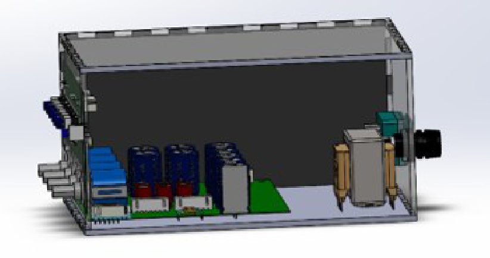
</p>

---

## Table of Contents

- [Features](#features)
- [Design Specifications](#design-specifications)
- [Repository Structure](#repository-structure)
- [System Overview](#system-overview)
- [Wave Generation](#wave-generation)
  - [Square Wave](#1-square-wave)
  - [Triangular Wave](#2-triangular-wave)
  - [PWM Wave](#3-pwm-wave)
  - [Sawtooth Wave](#4-sawtooth-wave)
  - [Sine Wave](#5-sine-wave)
- [Output Stage](#output-stage)
- [Power Supply](#power-supply)
- [Component Selection](#component-selection)
- [Simulations](#simulations)
- [Hardware Design](#hardware-design)
  - [Schematics](#schematics)
  - [PCB](#pcb)
  - [Gerber Files](#gerber-files)
  - [Enclosure](#enclosure)
- [Getting Started](#getting-started)
- [Discussion](#discussion)
- [Documentation](#documentation)

---

## Features

| Feature | Details |
|---|---|
| Waveforms | Square, Triangular, PWM, Sawtooth, Sine |
| Frequency range | 20 Hz – 20 kHz (multi-turn pot for fine tuning + switched capacitor bank for ranges) |
| Amplitude | Adjustable up to 20 Vpp |
| DC offset | Adjustable positive / negative shift |
| PWM duty cycle | 1 % – 99 % |
| Load | Drives a 50 Ω load through a push-pull output stage |
| Power | Mains powered, regulated ±12 V supply on board |
| Architecture | Fully analog, built around TL084 op-amps |

---

## Design Specifications

- Generate **sine, triangular, sawtooth, square and PWM** waves.
- Vary frequency from **20 Hz to 20,000 Hz**.
- Vary amplitude up to **20 V peak-to-peak**.
- Vary PWM pulse width from **1 % to 99 %**.
- Supply the waveforms to a **50 Ω load**.
- Add a **DC offset** to the output waveform.

---

## Repository Structure

```
Analog-Function-Generator/
├── README.md
├── Docs/
│   └── Report.pdf                 # Full project report
├── Simulation/
│   ├── Power_Supply/              # Power supply simulation files
│   ├── Output_Circuit/            # Summing amp + push-pull simulation
│   └── Main_Circuit/              # Wave generation simulation
├── Hardware/
│   ├── Schematics/                # Circuit schematics (source + PDF)
│   ├── PCB/                       # PCB layout source files
│   └── Gerber/                    # Fabrication-ready Gerber + drill files
├── Enclosure/                     # 3D enclosure design files (CAD / STL)
└── images/                        # Figures used in this README
```

> Change the folder names above to match your repo if they differ.

---

## System Overview

```
             ┌──────────────┐    ┌──────────────┐    ┌──────────────┐
             │   Schmitt    │    │  Integrator  │    │  Low-pass    │
 Freq. ────▶ │   Trigger    │──▶ │  (Triangle / │──▶ │   Filter     │──▶ Sine
 (R, C)      │ (Square)     │    │   Sawtooth)  │    │              │
             └──────┬───────┘    └──────┬───────┘    └──────────────┘
                    │                   │
                    │            ┌──────▼───────┐
                    │            │  Comparator  │──▶ PWM (duty adjust)
                    │            └──────────────┘
                    ▼
        Waveform selector (DPDT switches)
                    │
             ┌──────▼───────┐    ┌──────────────┐
             │   Summing    │    │  Push-Pull   │
             │  Amplifier   │──▶ │  (TIP31 /    │──▶ OUTPUT (50 Ω)
             │ (Gain+Offset)│    │   TIP32)     │
             └──────────────┘    └──────────────┘

        ±12 V Power Supply (Transformer → Bridge → Caps → 7812 / 7912)
```

---

## Wave Generation

### 1. Square Wave

The square wave comes from an op-amp **Schmitt trigger relaxation oscillator**. A capacitor on the inverting input charges and discharges through a feedback resistor. The positive feedback divider (R3, R4) sets the upper and lower switching thresholds.

<p align="center">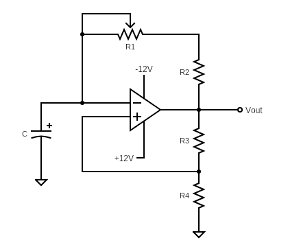</p>

**How it works**

1. At start-up the capacitor is uncharged, so V₂ (inverting input) = 0 and V_id = V₁ > 0. The output goes to **+V_sat**.
2. The capacitor charges toward +V_sat. When V₂ rises just above V₁, the output switches to **−V_sat**.
3. The threshold is now negative:

   ```math
   V_1 = -\frac{R_4}{R_3 + R_4} \cdot V_{sat}
   ```

4. The capacitor discharges toward −V_sat. When V₂ drops below V₁, the output switches back to +V_sat, and the cycle repeats.

**Frequency**

With $\beta = \frac{R_4}{R_3 + R_4}$ and $R = R_1 + R_2$ (the timing resistance):

```math
T = 2RC \cdot \ln\left(\frac{1+\beta}{1-\beta}\right) = 2RC \cdot \ln\left(\frac{2R_4 + R_3}{R_3}\right)
```

```math
f = \frac{1}{2RC \cdot \ln\left(\frac{2R_4 + R_3}{R_3}\right)} \quad \Rightarrow \quad f \propto \frac{1}{RC}
```

R₃ and R₄ are fixed, so the frequency is set by **R** (multi-turn potentiometer) and **C** (switched capacitor bank). The fixed resistor R₂ in series with the pot keeps the timing resistance from ever reaching zero.

### 2. Triangular Wave

There are two common methods:

- **Method I:** Square wave generator → **integrator**, which turns the square wave into a triangle.
- **Method II:** Take the voltage across the timing capacitor itself. In theory it is exponential, but near the threshold region it is close to linear (triangular).

We used **Method II** because it integrates easily with the rest of the circuit.

| Triangular Wave Generation | With Schmitt Trigger |
|---|---|
| 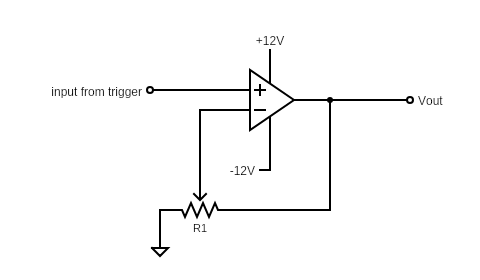 | 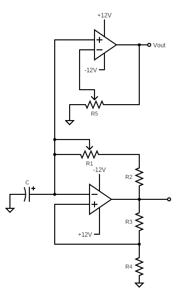 |

### 3. PWM Wave

PWM is made by feeding the **triangular wave into a comparator** and comparing it against an adjustable DC reference. Changing the reference voltage changes the duty cycle from **1 % to 99 %**.

<p align="center">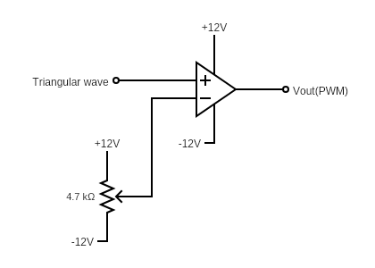</p>

### 4. Sawtooth Wave

A sawtooth is a triangular wave with **unequal rise and fall times**. We get it by **integrating the PWM signal**. Changing the PWM duty cycle changes the ratio of rise time to fall time:

- 50 % duty → symmetric **triangular** wave
- Duty toward 1 % / 99 % → **sawtooth** (ramp up / ramp down)

A DC voltage on the integrator's non-inverting input also shifts the rise and fall times. When it is zero, the output is a pure triangle.

<p align="center">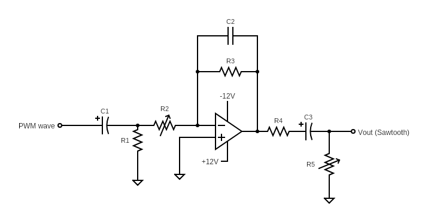</p>

### 5. Sine Wave

We considered several options: Wien bridge, phase-shift, Colpitts / crystal oscillators, pulse-based synthesis, and wave shaping with filtering. We chose **filtering**. By Fourier theory, a triangle wave is mostly its fundamental with small odd harmonics. Passing the **amplified triangular wave through a low-pass filter** removes the harmonics and leaves a sine wave at the same frequency.

<p align="center">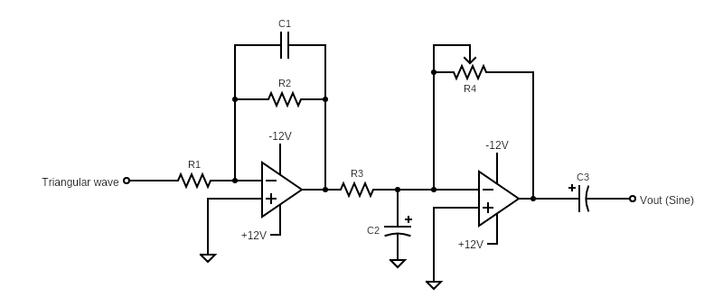</p>

---

## Output Stage

<p align="center">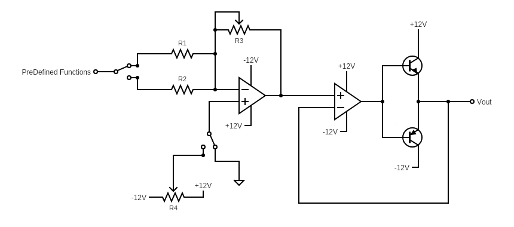</p>

### Summing Amplifier: Amplitude & DC Offset

```math
\text{Gain} = \frac{V_{out}}{V_{in}} = \frac{R_f}{R_{in}}
```

R_f = 10 kΩ is fixed, and R_in is variable:

| R_in | Gain |
|---|---|
| 10 kΩ | 1 |
| 1 kΩ | 10 |

Changing the voltage on the **non-inverting terminal** adds a **DC offset** to the output.

### Push-Pull Amplifier

A complementary **TIP31 (NPN) / TIP32 (PNP)** push-pull stage drives current in both directions through the load. One transistor sources current and the other sinks it. This gives the generator enough current to drive a 50 Ω load.

---

## Power Supply

<p align="center">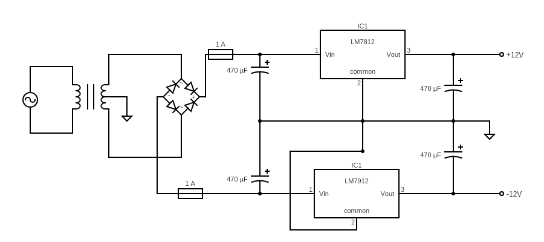</p>

This is lab equipment that has to run for long periods, so it is **mains powered** instead of battery powered.

```
Mains AC ─▶ Fuse ─▶ Step-down Transformer ─▶ Bridge Rectifier (GBU6M)
        ─▶ Smoothing Capacitors ─▶ LM7812 / LM7912 ─▶ Output Capacitors ─▶ ±12 V
```

- **Fuse:** protects the circuit
- **Full-wave bridge rectifier:** GBU6M / DGBU6A
- **Smoothing capacitors:** reduce ripple
- **LM7812 / LM7912:** regulated +12 V and −12 V rails
- **Output capacitors:** further improve rail quality

---

## Component Selection

| Part | Choice | Reason |
|---|---|---|
| Op-amp | **TL084** (quad JFET) | Low noise, high slew rate (~13 V/µs) for clean square-wave edges |
| Output transistors | **TIP31 / TIP32** | Complementary pair rated well above the required current/power |
| Regulators | **LM7812 / LM7912** | ±12 V rails for the op-amps and output stage |
| Bridge rectifier | **GBU6M / DGBU6A** | Full-wave rectification with high current margin |
| Frequency control | **Multi-turn potentiometer** | Fine frequency tuning |
| Frequency ranges | **Discrete switched capacitor set** | Coarse range selection |
| Selectors | **Locking DPDT switches** | Waveform / range selection |

<p align="center">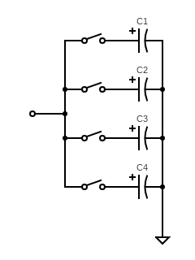</p>

**Op-amp bandwidth check** (from the report): with a GBW of 1 MHz at 20 kHz,

```math
\text{Max gain} = \frac{1 \times 10^{6}}{2 \times 10^{4}} = 50
```

**Output stage requirement** (20 Vpp → 10 V peak into 50 Ω):

```math
P_{max} = \frac{V_p^2}{R_L} = \frac{10^2}{50} = 2 \text{ W}
```

```math
I_{max} = \frac{V_p}{R_L} = \frac{10}{50} = 0.2 \text{ A} = 200 \text{ mA}
```

---

## Simulations

Simulation files are in [`Simulation/`](Simulation/).

### Power Supply

| Circuit | Output (±12 V rails) |
|---|---|
| 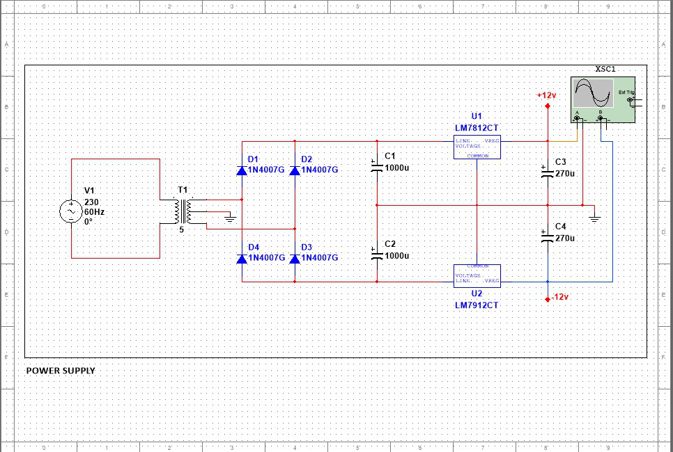 | 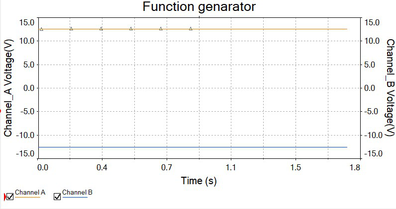 |

### Output Circuit

| Circuit | Input Signal |
|---|---|
| 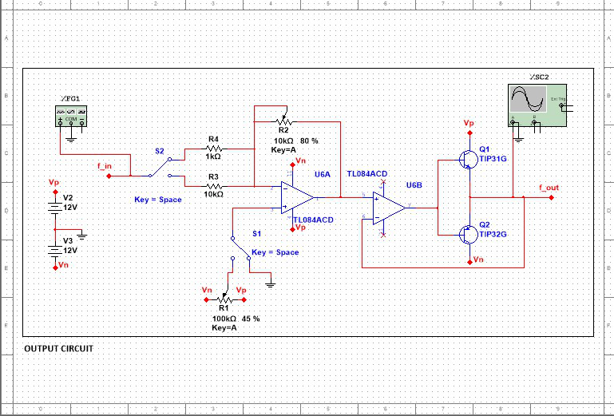 | 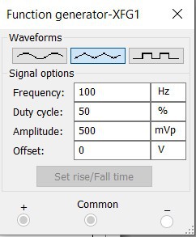 |

| Amplitude Change | DC Offset |
|---|---|
| 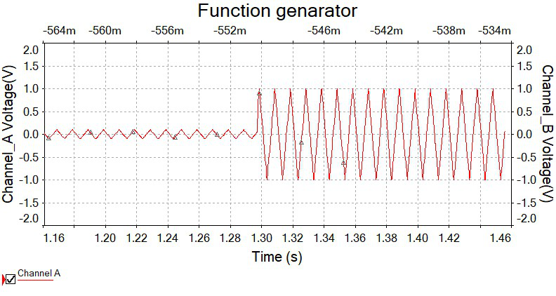 | 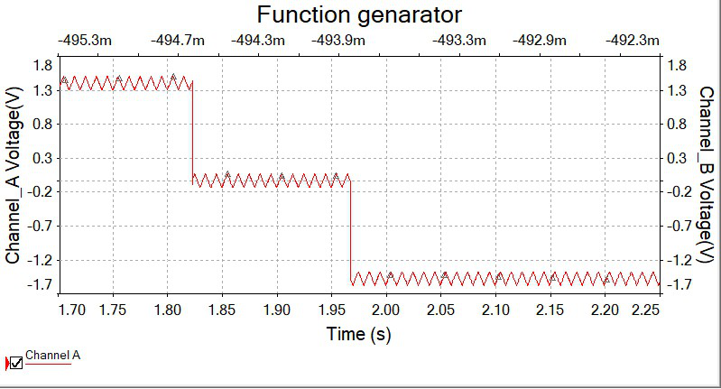 |

### Main Circuit

<p align="center">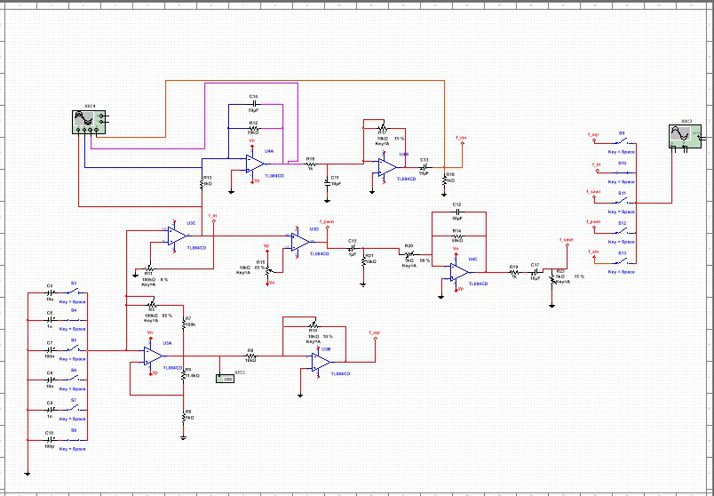</p>

**Frequency range** (measured with the frequency counter at the two ends of the range)

| Minimum (~20 Hz) | Maximum (~20 kHz) |
|---|---|
| 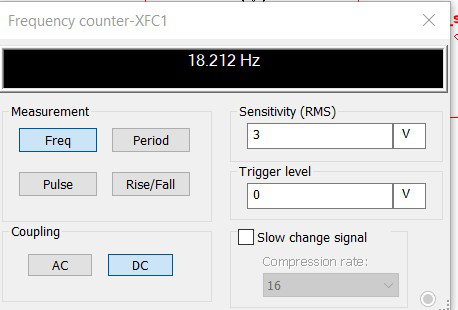 | 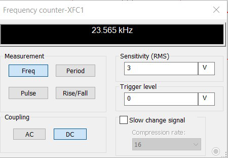 |

**Output waveforms**

| Square | Triangular |
|---|---|
| 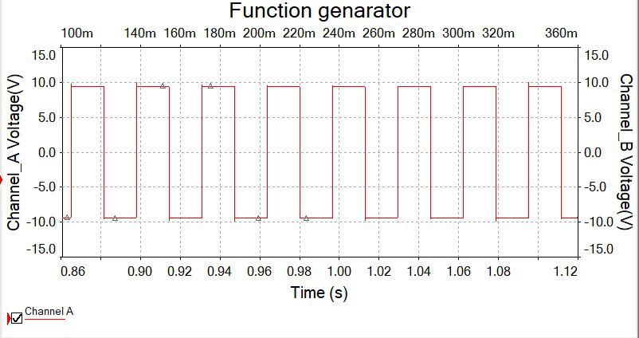 | 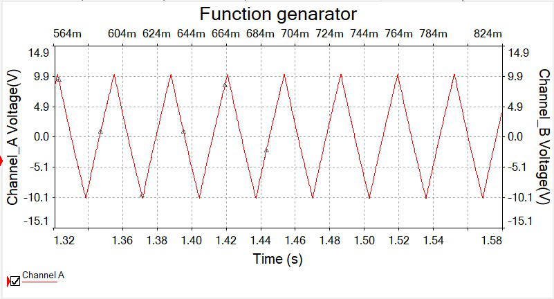 |

| PWM | Sawtooth |
|---|---|
| 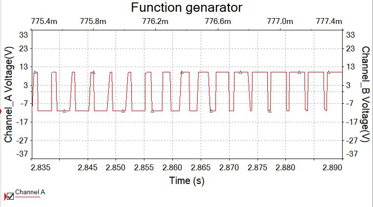 | 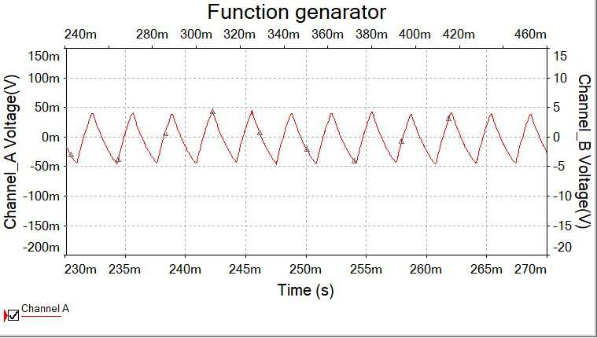 |

| Sine |
|---|
| 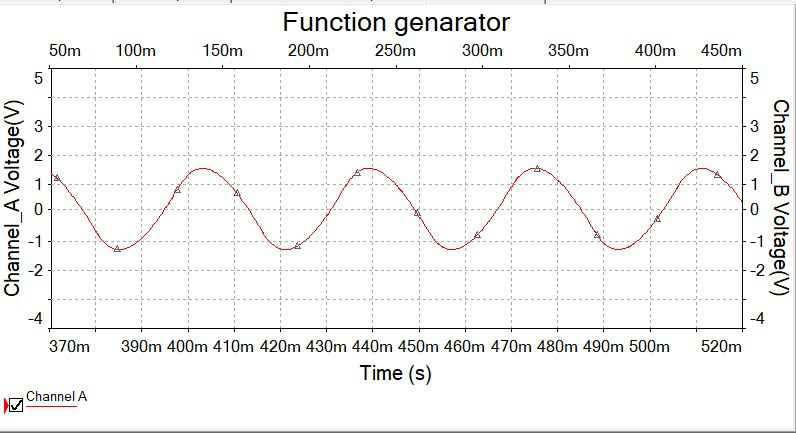 |

---

## Hardware Design

### Schematics

Full schematics are in [`Hardware/Schematics/`](Hardware/Schematics/).

The complete circuit (all wave-generation stages, capacitor bank and output switches) is shown in the [Main Circuit simulation](#main-circuit). Each stage is described in [Wave Generation](#wave-generation).

### PCB

The PCB layout source files are in [`Hardware/PCB/`](Hardware/PCB/). The design is split into three boards.

**Main Circuit Board**

<p align="center">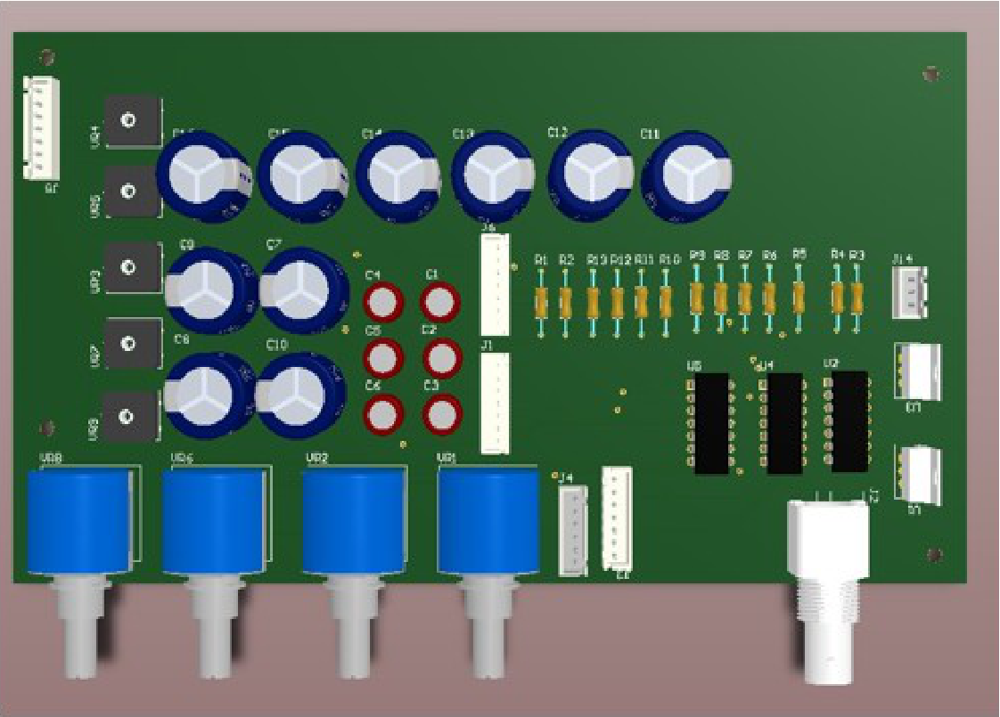</p>

| Button Panel | Power Supply |
|---|---|
| 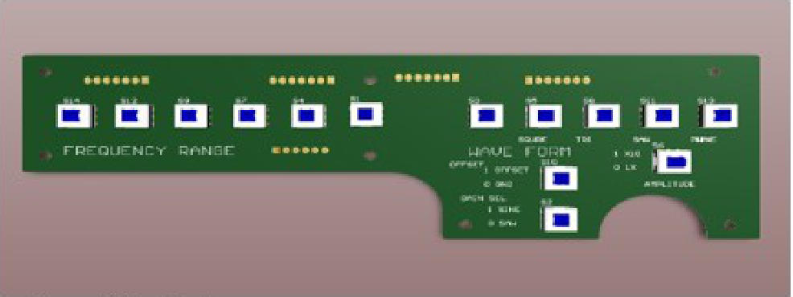 | 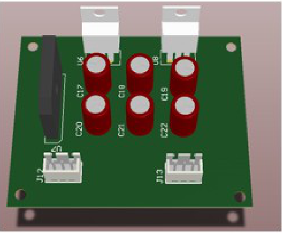 |

### Gerber Files

The fabrication-ready Gerber and drill files are in [`Hardware/Gerber/`](Hardware/Gerber/).

To order boards:
1. Zip the contents of `Hardware/Gerber/`.
2. Upload the zip to a PCB manufacturer (e.g. JLCPCB, PCBWay, OSH Park).
3. Check the layer preview, choose the board options, and place the order.

### Enclosure

The enclosure CAD files are in [`Enclosure/`](Enclosure/).

| Isometric | Front Panel | Back Panel |
|---|---|---|
|  | 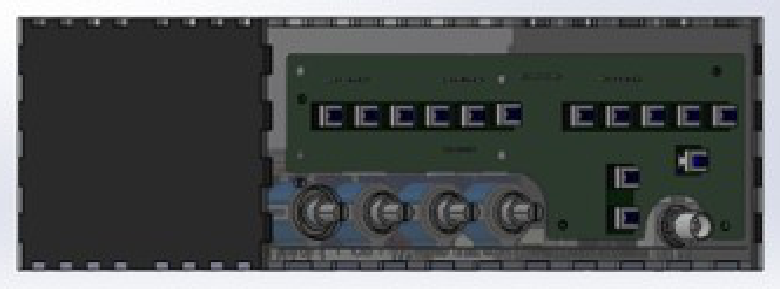 | 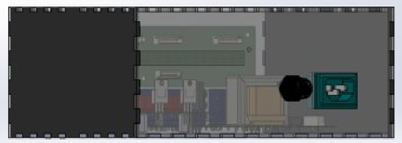 |

---

## Getting Started

1. **Clone the repo**
   ```bash
   git clone https://github.com/<your-username>/Analog-Function-Generator.git
   ```
2. **Run the simulations:** open the files in `Simulation/` with NI Multisim.
3. **Review the hardware:** open the schematic and PCB files in `Hardware/` with your EDA tool.
4. **Fabricate:** send `Hardware/Gerber/` to a PCB manufacturer.
5. **Assemble:** solder the components, fit the boards into the enclosure, and wire up the panel pots, switches and output connector.

> ⚠️ **Safety:** The power supply connects to **mains voltage**. Always use the fuse, insulate every mains connection, and never work on the board while it is plugged in.

---

## Discussion

Using only analog components, this design generates multiple waveforms and lets the user control **frequency, amplitude, DC offset, wave shape and duty cycle**. The op-amp is the main building block: it is used as comparators, inverters, amplifiers, integrators and a Schmitt trigger. Combining these stages with filters between them gives a fully working analog function generator.

---

## Documentation

The full project report, with detailed explanations, is in [`Docs/Report.pdf`](Docs/Report.pdf).

---

<p align="center"><i>If you find this project useful, consider giving it a ⭐</i></p>
